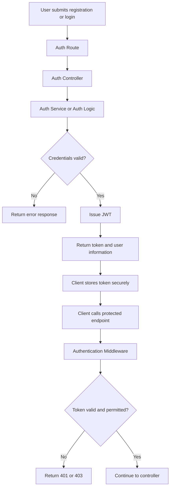
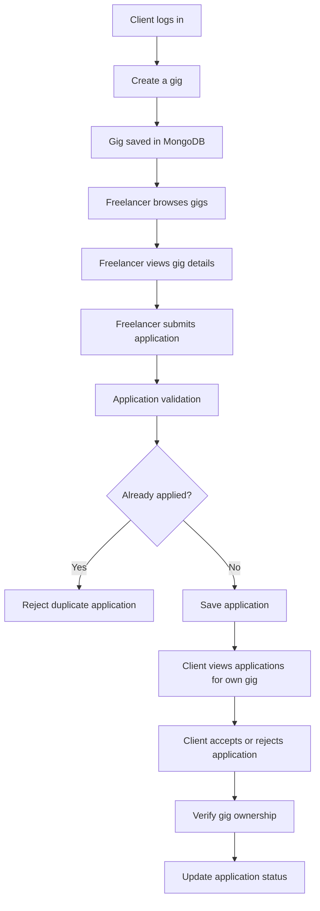
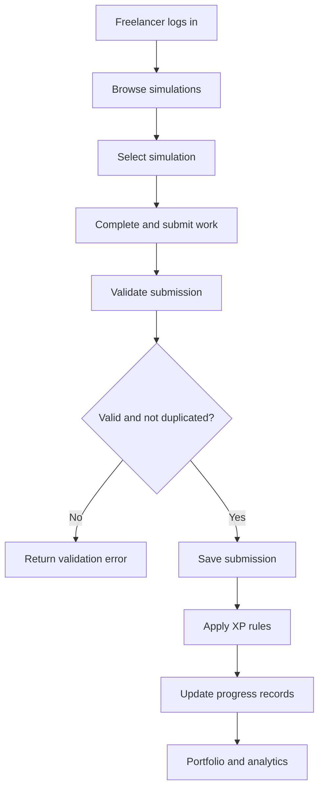
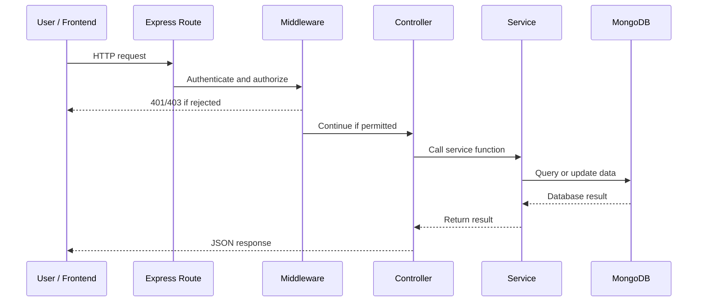
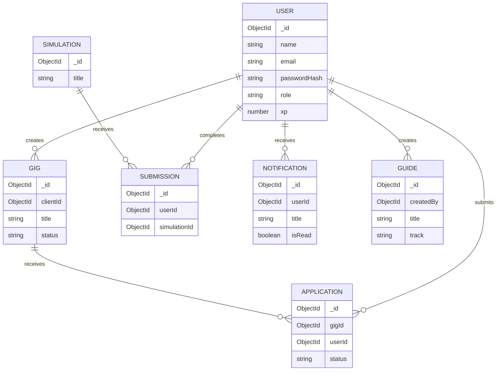

# SkillBridge — Hackathon Project

**A skills-development and opportunity-matching platform connecting freelancers with clients.**

SkillBridge is a web application designed to help freelancers develop practical skills, demonstrate their abilities, build a portfolio, and discover suitable work opportunities. Clients can publish gigs and review applications, while freelancers can practise through simulations and track their progress.

The platform combines gig management, skills development, portfolio tracking, and **SkillBridge Match**, which helps freelancers discover relevant opportunities.

---

## Table of Contents

1. Project Overview
2. Problem Statement
3. Project Goals
4. Features
5. Technology Stack
6. System Architecture
7. Data-Flow Diagrams
8. Project Folder Structure
9. File Responsibilities
10. API Documentation
11. Authentication and Permissions
12. Installation and Setup
13. Environment Variables
14. Demo Accounts
15. Testing the API
16. Database Models and Relationships
17. Security and Error Handling
18. Current Limitations
19. Future Enhancements
20. Developer

---

## 1. Project Overview

SkillBridge aims to bridge the gap between learning and employment by giving freelancers a place to practise skills, demonstrate progress, and apply for opportunities.

The platform supports two primary user roles:

- **Freelancer:** discovers gigs, applies for opportunities, completes simulations, earns XP, and tracks progress.
- **Client:** creates and manages gigs, receives applications, and accepts or rejects applicants.

Additional administrative functionality supports user oversight, learning resources, and platform analytics.

### Vision

To create an accessible platform where people can develop practical skills, demonstrate their capabilities, and connect with opportunities that match their potential.

## 2. Problem Statement

Freelancers and early-career professionals may struggle to find relevant opportunities, gain practical experience, and prove their skills to potential clients.

At the same time, clients need a way to publish opportunities and identify suitable applicants.

SkillBridge addresses these challenges by bringing together:

- Practical skills simulations.
- Gig discovery and applications.
- Skills and opportunity matching.
- Portfolio and XP tracking.
- Learning resources.
- Freelancer progress analytics.

## 3. Project Goals

The project aims to:

1. Connect clients with freelancers through gig listings and applications.
2. Give freelancers opportunities to practise practical skills.
3. Help freelancers demonstrate their learning and achievements.
4. Improve opportunity discovery through SkillBridge Match.
5. Provide a structured experience for clients and freelancers.
6. Establish a foundation for future learning, career-development, and recruitment features.

---

## 4. Features

The project covers the following feature areas. Features marked as new or requiring verification should be tested in the actual running application before being presented as fully operational.

| # | Feature | Description |
|---:|---|---|
| 1 | User registration | Allows users to create accounts. |
| 2 | User login | Authenticates users and issues access tokens. |
| 3 | Authentication and authorization | Protects endpoints and restricts access according to roles. |
| 4 | Role-based dashboards | Supports separate freelancer and client experiences. |
| 5 | Gig management | Enables clients to create, view, update, change the status of, and delete gigs. |
| 6 | Gig discovery | Allows users to browse available opportunities and view gig details. |
| 7 | Gig applications | Allows freelancers to apply for gigs and prevents duplicate applications. |
| 8 | Application management | Allows freelancers to view their applications and clients to review applicants for their own gigs. |
| 9 | SkillBridge Match | Recommends or identifies relevant opportunities for freelancers. |
| 10 | Skills simulations | Provides practical exercises that freelancers can complete. |
| 11 | Simulation submissions | Records submitted work and protects against duplicate submissions where configured. |
| 12 | XP and progress tracking | Tracks experience points earned through supported activities. |
| 13 | Portfolio | Presents a freelancer's recorded work and achievements. |
| 14 | Profile management | Allows users to maintain professional profile information. |
| 15 | Learning guides | Provides learning resources and guidance. |
| 16 | Notifications | Provides a structure for user notifications and read/unread tracking. |
| 17 | Freelancer analytics | Summarises progress, submissions, skills practiced, and application statuses. |
| 18 | Administration | Provides an administrative overview, user listing, and role management. |

**Important:** the number of feature areas is not the same as the number of fully completed features. The additional profile, guides, notifications, analytics, and administration features require their service files, routes, models, permissions, and database integration to be present and tested.

---

## 5. Technology Stack

| Technology | Purpose |
|---|---|
| Node.js | JavaScript runtime for the backend. |
| Express.js | HTTP server and API routing. |
| MongoDB | Document database. |
| Mongoose | Database models, validation, and queries. |
| JSON Web Tokens (JWT) | Token-based authentication. |
| bcrypt / bcryptjs | Password hashing, depending on the installed implementation. |
| Pino | Structured application and request logging, where configured. |
| dotenv | Loads environment variables from `.env`. |
| Nodemon | Restarts the development server when files change. |
| Bruno or Postman | API testing. |
| Git and GitHub | Source control and project collaboration. |

The frontend communicates with the backend through HTTP requests to the REST API.

---

## 6. System Architecture

SkillBridge uses a layered backend structure.

```text
                    USER / FRONTEND
                           |
                           v
                    HTTP API REQUEST
                           |
                           v
                 EXPRESS ROUTE HANDLERS
                           |
                 Authentication Middleware
                    and Role Checks
                           |
                           v
                      CONTROLLERS
                Request / Response Handling
                           |
                           v
                        SERVICES
                 Application Business Logic
                           |
                           v
                     MONGOOSE MODELS
                           |
                           v
                        MONGODB
```

### Responsibilities of each layer

**Routes**

Define the endpoint, HTTP method, middleware, and controller function.

**Middleware**

Checks authentication, roles, and administrative permissions before protected requests reach the controller.

**Controllers**

Receive requests, call service functions, return HTTP responses, and pass errors to the central error handler.

**Services**

Contain application logic, validation, permission checks that depend on business rules, database operations, and calculations.

**Models**

Define the structure and validation rules of MongoDB documents.

**Database**

Stores user accounts, gigs, applications, simulations, submissions, and other supported records.

### Architectural principle

Business logic belongs in `services/`, not directly in controllers. This makes the application easier to test, maintain, and extend.

---

## 7. Data-Flow Diagrams

### 7.1 Authentication flow



### 7.2 Gig application flow



### 7.3 Skills development and portfolio flow



The precise XP and submission rules depend on the implementation in the running backend.

### 7.4 General API request flow



---

## 8. Project Folder Structure

The structure below documents the expected backend organization. Keep the actual filenames in the repository aligned with the imports used by `server.js` and the route files.

```text
Server/
├── server.js
├── package.json
├── package-lock.json
├── .env                  # Local secrets; never commit
├── .env.example          # Safe configuration template
├── .gitignore
│
├── config/
│   └── database.js       # If database connection is separated
│
├── middleware/
│   ├── auth.js
│   ├── requireAdmin.js
│   └── errorHandler.js   # If a central handler is implemented
│
├── models/
│   ├── User.js
│   ├── Gig.js
│   ├── Application.js
│   ├── Simulation.js
│   ├── Submission.js
│   ├── Guide.js
│   └── Notification.js
│
├── routes/
│   ├── auth.js
│   ├── gigs.js
│   ├── applications.js
│   ├── simulations.js
│   ├── dashboard.js
│   ├── portfolio.js
│   ├── guides.js
│   ├── profileRoutes.js
│   ├── guideRoutes.js
│   ├── notificationRoutes.js
│   ├── analyticsRoutes.js
│   └── adminRoutes.js
│
├── controllers/
│   ├── authController.js
│   ├── gigController.js
│   ├── applicationController.js
│   ├── simulationController.js
│   ├── dashboardController.js
│   ├── portfolioController.js
│   ├── profileController.js
│   ├── guideController.js
│   ├── notificationController.js
│   ├── analyticsController.js
│   └── adminController.js
│
├── services/
│   ├── authService.js       # If separated from the controller
│   ├── gigService.js       # If separated from the controller
│   ├── applicationService.js
│   ├── simulationService.js
│   ├── profileService.js
│   ├── guideService.js
│   ├── notificationService.js
│   ├── analyticsService.js
│   └── adminService.js
│
└── scripts/
    └── seed.js              # If the seed script is located here
```

**Repository note:** this is a documentation map, not a claim that every listed file already exists. Remove entries that are not in your repository and add any actual files that are missing from the list.

### Important guide-route note

The project has previously used `routes/guides.js`, while the newer feature structure uses `routes/guideRoutes.js`. Avoid registering two competing routers for the same `/api/guides` prefix. Merge the guide endpoints into one router or deliberately configure the routes so their paths do not conflict.

---

## 9. File Responsibilities

### 9.1 Entry point and configuration

| File | Responsibility |
|---|---|
| `server.js` | Loads environment variables, configures Express and middleware, connects to MongoDB, mounts routers, and starts the HTTP server. |
| `package.json` | Lists dependencies and npm scripts such as `npm run dev`. |
| `package-lock.json` | Locks dependency versions for reproducible installation. |
| `.env` | Holds local database credentials, JWT secrets, and other private configuration. |
| `.env.example` | Documents required environment variable names without real credentials. |
| `config/database.js` | Optional separate module for connecting to MongoDB. |

### 9.2 Middleware

| File | Responsibility |
|---|---|
| `middleware/auth.js` | Verifies access tokens and exposes authentication and role-checking middleware such as `requireAuth` and `allowRoles`. |
| `middleware/requireAdmin.js` | Restricts administrative endpoints to the configured administrator. |
| `middleware/errorHandler.js` | Optional central handler for consistent error responses and status codes. |

### 9.3 Models

| Model | Responsibility |
|---|---|
| `User.js` | Stores account details, password hash, role, XP, and supported profile fields. |
| `Gig.js` | Stores job or freelance opportunity details, client ownership, and status. |
| `Application.js` | Connects a freelancer to a gig and stores application status. |
| `Simulation.js` | Stores practical exercises, instructions, and associated metadata. |
| `Submission.js` | Stores a freelancer's submitted simulation work and any recorded XP award. |
| `Guide.js` | Stores learning guide titles, summaries, content, tracks, tags, and creator references. |
| `Notification.js` | Stores recipient, notification type, message, read status, and related record. |

### 9.4 Routes

| File | Responsibility |
|---|---|
| `routes/auth.js` | Registration and login endpoints. |
| `routes/gigs.js` | Gig listing, details, creation, updates, deletion, status management, and application submission. |
| `routes/applications.js` | Freelancer application history and client review of gig applications. |
| `routes/simulations.js` | Simulation listing, details, and submission endpoints. |
| `routes/dashboard.js` | Role-specific dashboard data. |
| `routes/portfolio.js` | Freelancer portfolio endpoint. |
| `routes/guides.js` or `routes/guideRoutes.js` | Learning guide endpoints; use one coordinated router. |
| `routes/profileRoutes.js` | Profile retrieval and updates. |
| `routes/notificationRoutes.js` | Notification listing and read-state changes. |
| `routes/analyticsRoutes.js` | Freelancer analytics endpoint. |
| `routes/adminRoutes.js` | Administrative overview and user management. |

### 9.5 Controllers

| File | Responsibility |
|---|---|
| `authController.js` | Handles HTTP responses for authentication requests. |
| `gigController.js` | Delegates gig requests to the gig service or existing gig logic. |
| `applicationController.js` | Delegates application requests to the application service. |
| `simulationController.js` | Handles HTTP responses for simulation operations. |
| `dashboardController.js` | Returns dashboard data. |
| `portfolioController.js` | Returns portfolio data. |
| `profileController.js` | Calls profile service functions. |
| `guideController.js` | Calls guide service functions. |
| `notificationController.js` | Calls notification service functions. |
| `analyticsController.js` | Calls the analytics service. |
| `adminController.js` | Calls administrative service functions. |

### 9.6 Services

| File | Responsibility |
|---|---|
| `authService.js` | Optional service layer for registration, password verification, and token-related logic. |
| `gigService.js` | Optional service layer for gig validation, persistence, and ownership rules. |
| `applicationService.js` | Optional service layer for duplicate prevention, application status updates, and gig ownership validation. |
| `simulationService.js` | Optional service layer for submission validation and XP rules. |
| `profileService.js` | Profile field validation, retrieval, and updates. |
| `guideService.js` | Guide listing, filtering, creation, editing, deletion, and permissions. |
| `notificationService.js` | Notification listing, creation, and read-state changes. |
| `analyticsService.js` | Calculates progress, submission totals, and application statistics. |
| `adminService.js` | Administrative counts, user listing, search, and role changes. |

The original working routes and services should be preserved. Only add or replace files after checking how the existing application is organized.

---

## 10. API Documentation

**Base URL for local development**

```text
http://localhost:5000
```

Protected endpoints require a valid access token, normally supplied through:

```http
Authorization: Bearer YOUR_JWT_TOKEN
```

The endpoint list below reflects the known route structure. Verify each endpoint against the actual router before using this document as proof that every feature is operational.

### 10.1 Authentication

| Method | Endpoint | Purpose | Access |
|---|---|---|---|
| `POST` | `/api/auth/register` | Register an account. | Public |
| `POST` | `/api/auth/login` | Authenticate and obtain a token. | Public |

Example registration request:

```json
{
  "name": "Demo Freelancer",
  "email": "freelancer@example.com",
  "password": "ReplaceWithDemoPassword123!",
  "role": "freelancer"
}
```

Example login request:

```json
{
  "email": "freelancer@example.com",
  "password": "ReplaceWithDemoPassword123!"
}
```

These are example payloads, not pre-created credentials. The actual accepted fields must match the authentication controller and validation rules.

### 10.2 Dashboard

| Method | Endpoint | Purpose | Access |
|---|---|---|---|
| `GET` | `/api/dashboard` | Returns dashboard data for the authenticated user, according to the implementation. | Authenticated |

### 10.3 Gigs

| Method | Endpoint | Purpose | Access |
|---|---|---|---|
| `GET` | `/api/gigs` | List available gigs. | As configured |
| `GET` | `/api/gigs/:id` | View one gig. | As configured |
| `POST` | `/api/gigs` | Create a gig. | Client |
| `PATCH` | `/api/gigs/:id` | Update a gig. | Client; ownership should be checked |
| `PATCH` | `/api/gigs/:id/status` | Change a gig's status. | Client; ownership should be checked |
| `DELETE` | `/api/gigs/:id` | Delete a gig. | Client; ownership should be checked |
| `POST` | `/api/gigs/:id/apply` | Apply for a gig. | Freelancer |

The service should ensure that clients can manage only their own gigs and freelancers cannot apply multiple times to the same gig.

### 10.4 Applications

| Method | Endpoint | Purpose | Access |
|---|---|---|---|
| `GET` | `/api/applications/me` | List the authenticated freelancer's applications. | Freelancer |
| `GET` | `/api/applications/gig/:gigId` | List applications for a specific gig. | Client; ownership checked in service |
| `PATCH` | `/api/applications/:id/status` | Accept or reject an application. | Client; ownership checked in service |

Example status update:

```json
{
  "status": "accepted"
}
```

The valid status values must match the `Application` model and service validation. For example, `accepted` and `rejected` should be accepted only if they are supported by the actual implementation.

The current application router uses `:id` for the status endpoint. The controller should read `req.params.id` to match it.

### 10.5 Simulations and submissions

| Method | Endpoint | Purpose | Access |
|---|---|---|---|
| `GET` | `/api/simulations` | List available simulations. | As configured |
| `GET` | `/api/simulations/:id` | View one simulation. | As configured |
| `POST` | `/api/simulations/:id/submit` | Submit work for a simulation. | Authenticated; intended for freelancers |

Submission fields depend on the simulation controller and model. Check the implementation for the exact required request body.

### 10.6 Portfolio

| Method | Endpoint | Purpose | Access |
|---|---|---|---|
| `GET` | `/api/portfolio/me` | Retrieve the authenticated freelancer's portfolio. | Authenticated; intended for freelancers |

### 10.7 SkillBridge Match

| Method | Endpoint | Purpose | Access |
|---|---|---|---|
| `GET` | `/api/skillmatch/me` | Retrieve opportunity matches for the authenticated freelancer. | Authenticated; intended for freelancers |

The matching logic should explain or expose why opportunities are considered relevant, where supported by the implementation.

### 10.8 Profile management

These endpoints belong to the additional profile router.

| Method | Endpoint | Purpose | Access |
|---|---|---|---|
| `GET` | `/api/profile/me` | Retrieve the current user's profile. | Authenticated |
| `PATCH` | `/api/profile/me` | Update permitted profile fields. | Authenticated |

Supported fields in the proposed profile service are `name`, `bio`, `location`, `skills`, `headline`, and `website`. They must also exist in the `User` schema to be persisted.

### 10.9 Learning guides

| Method | Endpoint | Purpose | Access |
|---|---|---|---|
| `GET` | `/api/guides` | List learning guides. | Public, if configured as shown |
| `GET` | `/api/guides?track=Data%20Analytics` | Filter guides by learning track. | Public, if supported |
| `GET` | `/api/guides/:id` | Retrieve a guide. | Public, if configured as shown |
| `POST` | `/api/guides` | Create a guide. | Client or configured admin, according to the proposed service |
| `PATCH` | `/api/guides/:id` | Update a guide. | Creator or admin |
| `DELETE` | `/api/guides/:id` | Delete a guide. | Creator or admin |

Only one guide router should own these endpoints.

### 10.10 Notifications

| Method | Endpoint | Purpose | Access |
|---|---|---|---|
| `GET` | `/api/notifications/me` | List the current user's notifications. | Authenticated |
| `GET` | `/api/notifications/me?unread=true` | List unread notifications. | Authenticated |
| `PATCH` | `/api/notifications/:id/read` | Mark one notification as read. | Authenticated; own notification only |
| `PATCH` | `/api/notifications/read-all` | Mark all the current user's notifications as read. | Authenticated |

Notifications should be scoped to the logged-in user so that one user cannot read or modify another user's notifications.

Creating a notification service does not automatically trigger notifications when applications change. Those workflows must explicitly call the notification service.

### 10.11 Freelancer analytics

| Method | Endpoint | Purpose | Access |
|---|---|---|---|
| `GET` | `/api/analytics/me` | Retrieve personal progress and application statistics. | Freelancer |

The proposed analytics response includes XP, completed submissions, skill tracks practised, application counts, and recent submissions. The returned fields depend on the actual model schemas and service implementation.

### 10.12 Administration

| Method | Endpoint | Purpose | Access |
|---|---|---|---|
| `GET` | `/api/admin/overview` | Retrieve platform summary counts. | Configured admin |
| `GET` | `/api/admin/users` | List and search users with pagination. | Configured admin |
| `PATCH` | `/api/admin/users/:id/role` | Change a user's role. | Configured admin |

Example query:

```text
GET /api/admin/users?page=1&limit=20&role=freelancer&search=demo
```

Example role update:

```json
{
  "role": "client"
}
```

The proposed admin middleware uses `ADMIN_EMAIL` to identify the administrator. Configure it securely and ensure the central error handler handles service errors with a `status` property.

### API status codes

| Status | Meaning |
|---|---|
| `200 OK` | Request succeeded. |
| `201 Created` | Resource created successfully. |
| `400 Bad Request` | Invalid request or validation failure. |
| `401 Unauthorized` | Missing, invalid, or expired authentication token. |
| `403 Forbidden` | Authenticated user lacks permission. |
| `404 Not Found` | Resource does not exist or is not accessible. |
| `409 Conflict` | Duplicate or conflicting operation, if handled that way. |
| `500 Internal Server Error` | Unexpected server error. |

The actual response bodies and status codes depend on the route, controller, service, and central error handler.

---

## 11. Authentication and Permissions

SkillBridge uses JWT-based authentication for protected endpoints.

### Authentication process

1. A user registers or logs in.
2. The backend validates the submitted details.
3. The password is verified using the configured password-hashing library.
4. The backend issues a JWT when authentication succeeds.
5. The frontend includes the token in the `Authorization` header for protected requests.
6. Middleware verifies the token and exposes the authenticated user to downstream handlers.

### Role-based access

| Action | Freelancer | Client | Admin |
|---|---:|---:|---:|
| Browse gigs | Yes, subject to route configuration | Yes, subject to route configuration | According to permissions |
| Apply for gigs | Yes | No | According to permissions |
| View own applications | Yes | No | According to permissions |
| Review applications for own gigs | No | Yes | According to permissions |
| Create and manage own gigs | No | Yes | According to permissions |
| Complete simulations | Yes | No | According to permissions |
| View own portfolio and analytics | Yes | Not intended | According to permissions |
| Manage learning guides | According to configuration | According to configuration | If configured |
| Manage users | No | No | Configured admin only |

**Security requirement:** hiding an action in the frontend is not sufficient. The backend must enforce role checks and resource ownership.

---

## 12. Installation and Setup

### Prerequisites

Install or obtain access to:

- Node.js and npm.
- MongoDB locally or a MongoDB Atlas cluster.
- Git.
- An API client such as Bruno or Postman.

### Step 1: Clone the repository

Use the repository URL for the actual SkillBridge project:

```bash
git clone YOUR_REPOSITORY_URL
cd SkillBridge_Hackathon/Server
```

If the repository has already been cloned, navigate directly to its `Server` directory.

### Step 2: Install dependencies

```bash
npm install
```

### Step 3: Configure environment variables

Create a local `.env` file in the backend directory. Use `.env.example` as a template if it exists.

Example template:

```dotenv
PORT=5000
MONGODB_URI=YOUR_MONGODB_CONNECTION_STRING
JWT_SECRET=YOUR_LONG_RANDOM_SECRET
JWT_EXPIRES_IN=7d

# Optional if the administration middleware is enabled
ADMIN_EMAIL=YOUR_ADMIN_EMAIL
```

Use the exact variable names expected by the actual source code. Do not commit the real `.env` file.

### Step 4: Start the development server

```bash
npm run dev
```

The backend should start on the configured port, normally `5000`.

If the project defines a health-check endpoint, use that endpoint to verify the server and database connection. Do not assume that an endpoint exists without checking `server.js` and the mounted routers.

### Step 5: Test the API

Open Bruno or Postman, configure the local base URL, and test registration and login first. Copy the returned JWT into the authorization settings for protected requests.

---

## 13. Environment Variables

| Variable | Purpose | Required |
|---|---|---|
| `PORT` | HTTP server port. | Usually |
| `MONGODB_URI` | MongoDB connection string. | Yes |
| `JWT_SECRET` | Secret used to sign and verify JWTs. | Yes |
| `JWT_EXPIRES_IN` | Token expiry duration, if supported. | Depends on implementation |
| `ADMIN_EMAIL` | Identifies the configured admin if `requireAdmin.js` uses this setting. | Required for that admin middleware |

Use strong, unique values for secrets. The example values above are placeholders, not production credentials.

---

## 14. Demo Accounts

Demo credentials must correspond to accounts actually created by the seed script or registered in the database.

**Do not assume that the example credentials below work. Replace them with the exact credentials from your seed script or create the demo accounts before the presentation.**

| Account | Email | Password | Role |
|---|---|---|---|
| Demo Freelancer | `REPLACE_WITH_SEEDED_FREELANCER_EMAIL` | `REPLACE_WITH_SEEDED_FREELANCER_PASSWORD` | `freelancer` |
| Demo Client | `REPLACE_WITH_SEEDED_CLIENT_EMAIL` | `REPLACE_WITH_SEEDED_CLIENT_PASSWORD` | `client` |
| Demo Admin, if enabled | `REPLACE_WITH_ADMIN_EMAIL` | Use the configured admin account's real password | Administrator |

### Preparing demo accounts

1. Inspect the project's seed script and identify the accounts it actually creates.
2. Confirm whether passwords are stored as hashes and whether the seed script sets or generates the original passwords.
3. Run the seed script using the documented command, if one exists.
4. Confirm both demo accounts can log in.
5. Test that the freelancer account cannot perform client-only actions.
6. Test that the client can review applications only for gigs they own.
7. Confirm the admin account is restricted to the intended administrator.

Never put real database credentials, JWT secrets, or production account passwords in a public README.

---

## 15. Testing the API

Recommended minimum test sequence for a hackathon demonstration:

| Step | Test | Expected result |
|---:|---|---|
| 1 | Register a freelancer. | Account is created. |
| 2 | Log in as the freelancer. | Token is returned. |
| 3 | Request the freelancer dashboard. | Dashboard data is returned. |
| 4 | Browse gigs. | Available gigs are returned. |
| 5 | Apply for a gig. | Application is created. |
| 6 | Apply for the same gig again. | Duplicate is prevented if configured. |
| 7 | Log in as the owning client. | Client receives a valid token. |
| 8 | View applications for the client's gig. | Applications are returned. |
| 9 | Accept or reject an application. | Status changes according to the rules. |
| 10 | Browse simulations and submit work. | Submission is recorded. |
| 11 | Retrieve portfolio and matching results. | Relevant data is returned. |
| 12 | Test profile, guides, notifications, analytics, and admin routes. | Each feature returns expected results when integrated. |
| 13 | Attempt a forbidden operation. | The API rejects the request. |
| 14 | Restart the server and check persistence. | Saved records remain in MongoDB. |

### Additional checks

- Missing token on protected endpoints.
- Expired or invalid token.
- Invalid MongoDB document IDs.
- Missing required fields.
- Attempts to modify another user's data.
- Duplicate applications and submissions.
- Invalid role updates.
- MongoDB connection failure.
- Unexpected service errors.

A successful server startup alone does not prove that all API endpoints work. Test each important route with real requests.

---

## 16. Database Models and Relationships

The following conceptual relationships describe the expected data model. Confirm the exact field names and references in the Mongoose schemas.



### Data integrity

Where appropriate, the backend should enforce:

- Unique user email addresses.
- Unique application per freelancer and gig.
- Unique submission per freelancer and simulation if that is the intended rule.
- Valid role and status values.
- References to existing users, gigs, and simulations.
- Ownership restrictions for client operations.
- User-specific access to notifications and profiles.

The diagram is conceptual; the real database relationships are determined by the existing Mongoose schemas and indexes.

---

## 17. Security and Error Handling

Security measures to implement and verify include:

- Password hashing before storage.
- JWT verification for protected routes.
- Role-based authorization.
- Resource ownership checks.
- Request validation and safe error handling.
- Protection against duplicate applications and submissions.
- Environment variables for secrets and database credentials.
- No passwords or tokens in application logs.
- No secrets committed to GitHub.
- Rate limiting for sensitive endpoints such as login, where practical.
- Appropriate CORS configuration for the frontend.
- A central error handler that returns safe messages without exposing stack traces in production.

If a MongoDB URI or JWT secret has been exposed publicly, rotate it before using the application in a real environment.

---

## 18. Current Limitations and Verification Notes

The following items should be confirmed against the actual repository before claiming full completion:

1. **Service integration:** each controller must import an existing service with matching exported function names.
2. **Route registration:** all intended routers must be mounted in `server.js`.
3. **Guide routes:** avoid conflicting guide routers registered under the same prefix.
4. **Profile schema:** the `User` schema must include any additional profile fields being updated.
5. **Notifications:** notifications are not automatic until relevant application workflows call the notification service.
6. **XP calculations:** confirm the conditions under which XP is awarded and how duplicate awards are prevented.
7. **Analytics:** ensure aggregation fields match the actual application and submission schemas.
8. **Admin access:** configure `ADMIN_EMAIL` and test that only the intended administrator can access administrative endpoints.
9. **Demo credentials:** replace placeholders with working accounts.
10. **Frontend integration:** verify that the frontend calls the correct API URLs, sends the JWT, and handles errors.
11. **Testing:** test the important endpoints using the running application and MongoDB.

This section should be updated as each item is verified.

---

## 19. Future Enhancements

### Priority 1 — Core platform reliability

- Automated unit and integration tests.
- API documentation using Swagger/OpenAPI.
- Improved request validation.
- Standardized error responses.
- Automated notifications for application status changes.
- Better logging and operational health checks.
- CI checks for linting and tests.

### Priority 2 — Freelancer experience

- Public freelancer profiles with privacy controls.
- Verified skills and certifications.
- File and document uploads for portfolio evidence.
- More detailed XP history and achievement badges.
- Skill progression and learning recommendations.
- Saved gigs and application reminders.

### Priority 3 — Client experience

- Advanced freelancer search and filtering.
- Better applicant comparison tools.
- Client feedback and freelancer reviews.
- Interview scheduling.
- Clearer gig lifecycle management.
- Notifications when freelancers apply.

### Priority 4 — Matching and recommendations

- Transparent match scores.
- Match explanations based on skills and gig requirements.
- Recommendations based on simulation performance.
- Filters for skill level, location, availability, and category.
- Evaluation of matching quality using test data.

### Priority 5 — Platform administration

- Administrative dashboard with platform metrics.
- Account moderation and reporting.
- Audit trail for administrative actions.
- Abuse reporting and dispute management.
- Role management with stronger administrative controls.

### Priority 6 — Production readiness

- Deployment configuration.
- CI/CD pipeline.
- Automated backups and recovery procedures.
- Rate limiting and stronger security monitoring.
- Performance optimization and database index review.
- Accessibility and responsive-design improvements.
- Privacy policy, terms of use, and data-retention rules.

These are future improvements, not claims about existing functionality.

---

## 20. Developer

**Developed by: Khuliso John Thavhiwa**

Backend development, API architecture, database integration, authentication, and feature implementation for the SkillBridge Hackathon project.

*SkillBridge — Bridging skills, talent, and opportunities.*

